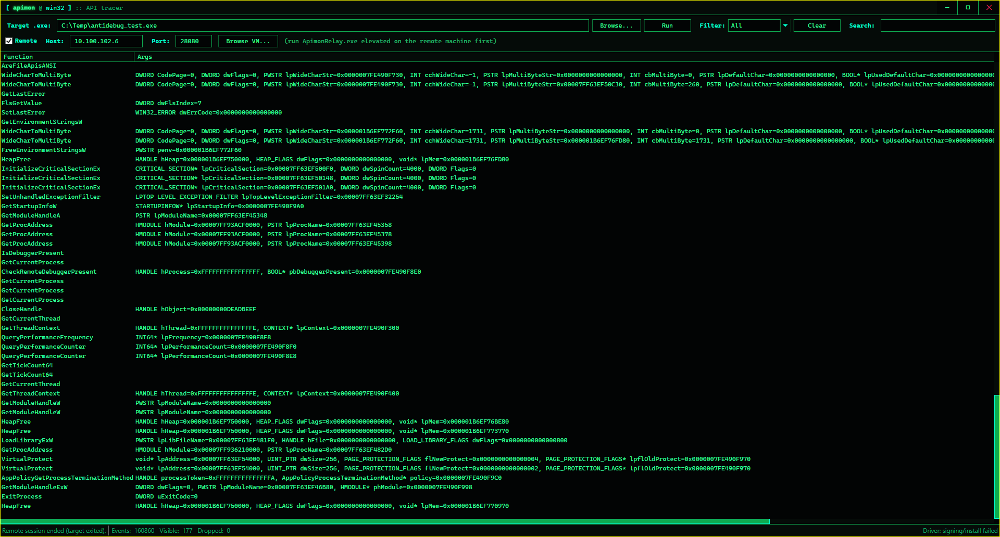

# APIMonitor

A Windows API call tracer. It launches a target application, injects a lightweight hook into it, and shows every Windows API call the app makes — with the function name, its arguments, and its return value — live in a dark "terminal" GUI. Works for both 32-bit and 64-bit targets, locally or on a remote machine.

## Features

- **Live API tracing** for x86 and x64 targets: function name, typed arguments, and return value.
- **Readable arguments** — parameter names and types come from Windows metadata; string pointers are shown as their text, handles and flags as hex.
- **Search** across function names, arguments, and return values, plus a source filter (user-mode API / COM).
- **Remote monitoring** — run a small relay on another machine or VM, point the GUI at it, and watch the calls stream back over the network.
- **Remote file picker** — browse the remote machine's filesystem from the GUI and pick the executable to trace.
- Optional kernel-mode assist for launching protected / mitigation-locked processes.

## Requirements

- Windows 10 / 11.
- Administrator rights (injection requires elevation).
- To build: Visual Studio 2022 with the C++ and .NET desktop workloads, the MASM build customization (for the x64 component), and the .NET Framework 4.8 targeting pack. The optional kernel driver additionally needs the Windows Driver Kit (WDK).

## Building

Open the solution in Visual Studio and build the **Release | x64** configuration. All components are produced into a single output folder so they sit next to each other. The optional driver builds only if the WDK is installed; everything else works without it.

## Usage

### Local

1. Run the GUI **as administrator**.
2. Pick a target executable with **Browse...**.
3. Click **Run**. The target launches with the hook injected and its API calls appear in the table as they happen.
4. Use **Search** to filter rows, the source dropdown to narrow by category, **Clear** to reset, and **Stop** to end the session.

### Remote (another machine / VM)

1. Copy the built output folder to the remote machine (it must contain the relay executable, the hook libraries, and the 32-bit injector helper).
2. On the remote machine, run the relay **as administrator** (optionally pass a port number; the default is 28080). Open that port in the remote firewall.
3. In the GUI, tick **Remote** and enter the remote machine's **Host** and **Port**.
4. Click **Browse VM...** to browse the remote filesystem and choose the target there (or type its remote path into the target field).
5. Click **Run**. The relay launches and injects the target on the remote machine and streams its calls back to the GUI.

> In remote mode, string arguments are shown as typed hex values rather than expanded text, and the kernel-mode assist is not used.

## Notes & limitations

- Return-value capture is reliable on x64. On x86 it can be unstable for applications that make heavy use of win32k user callbacks (notably some GUI apps built without a C runtime).
- Inline hooking is inherently invasive: heavily API-bound applications run noticeably slower while traced, and some programs may not tolerate being hooked.
- Tracing system-critical processes is not recommended — destabilizing such a process can affect the whole session.

See `CHANGELOG.md` for the version history.
